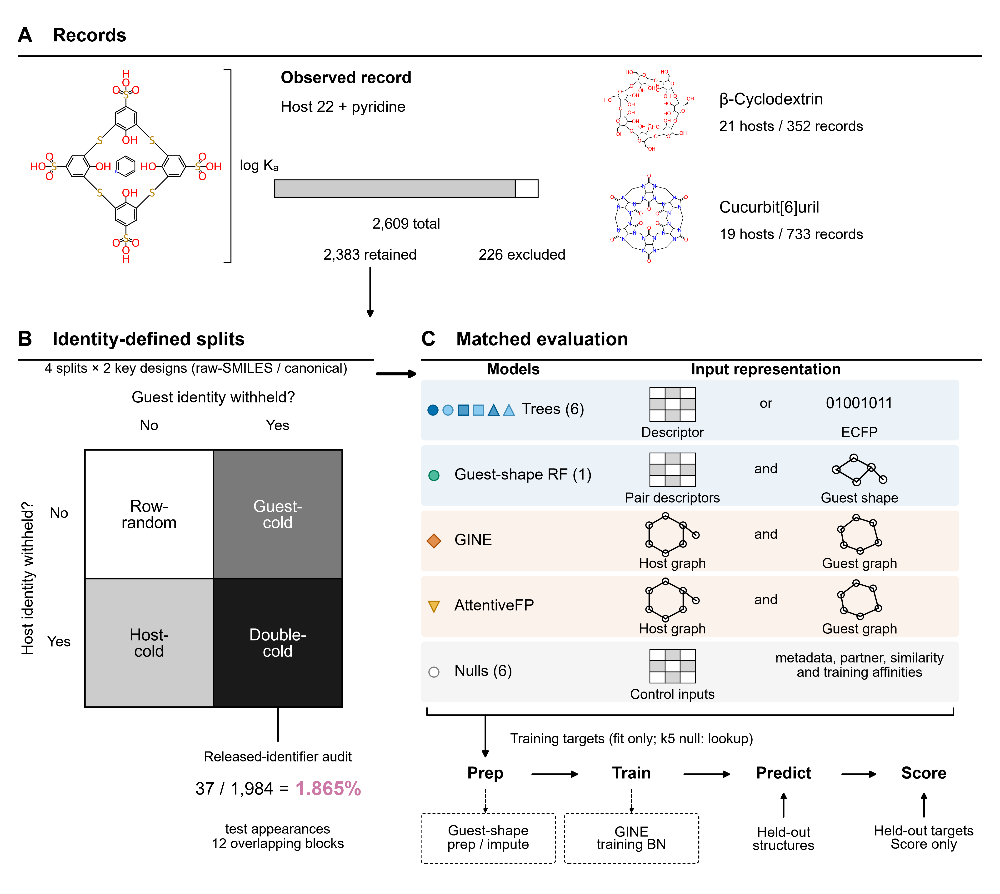

# Cold-Split Evaluation of Host–Guest Affinity Prediction in SupraBench

Yue Zhang, Dong-Jun Yu and Qi Zhang

Code, frozen evaluation inputs and saved predictions for this study of host–guest binding-affinity prediction in SupraBench.

The study uses 2,383 structure-valid records (filtered from 2,609 released measurements) and six matched null controls to examine how molecular identity rules and score aggregation shape cold-split conclusions:

- **Identity rules and score aggregation:** On canonical-key splits, descriptor random forest (RF) beats the strongest pooled null across host-cold ($R^2 = 0.442$), guest-cold ($0.646$) and double-cold ($0.380$) splits, while single-initialization AttentiveFP has positive pooled margins on all three splits but a $-0.0236$ equal-block double-cold mean margin. In the separate released-identifier double-cold design, descriptor-RF averages a $+0.0904$ five-seed equal-block margin, whereas GINE and AttentiveFP average negative margins.
- **Operational-parent recurrence and fixed-test training purge (E1):** Excluding test appearances with operational-parent recurrence keeps fixed-prediction descriptor-RF margins positive across released and canonical splits. With all 1,716 canonical double-cold test appearances fixed, purging training records sharing a test operational-parent key leaves RF's equal-block margin positive ($+0.1178$; unpurged baseline $+0.1198$), but $0.0095$ below the mean of three size-matched random-purge controls.
- **Host-family holdouts and cyclodextrin rank decomposition (E2):** Across four supported host-family holdouts, descriptor-RF beats the strongest guarded null only in the heterogeneous "other" cohort, while all tested models and the guest-only null combine positive family-pooled rank correlation with negative $R^2$ on cyclodextrin. Descriptor-RF's pooled Spearman correlation gain over guest-only RF on cyclodextrin comes from a larger between-host contribution, whereas its normalized within-host term is lower and dominated by one host.

These retrospective comparisons separate signal beyond matched controls from identity recurrence and distinguish family-pooled rank ordering from absolute-scale affinity accuracy before prospective application.



**Figure 1.** Study overview ([600 dpi PNG](figures/Figure_1.png) | [vector PDF](figures/Figure_1.pdf)): (A) structure-validity filtering (2,609 to 2,383 records; 2D depictions, not 3D poses), (B) independent raw-SMILES and canonical-key split designs, and (C) matched evaluation against six null controls across Prep → Train → Predict → Score. Training targets enter fitting or lookup only, and held-out targets enter scoring only.

## Quick check of saved results

Use Python 3.11.15 with the pinned verification dependencies in a separate environment:

```bash
python -m pip install -r environments/verify.txt
python verify.py
```

The command writes to a fresh subdirectory under `runs/`. Once dependencies are available, it uses the supplied local records and predictions without downloading the upstream raw dataset or training a model. It reports the four core saved-result groups, canonical CPU and E1 saved-prediction rescoring, and additional-analysis binding and selected-output checks separately.

[REPRODUCING.md](REPRODUCING.md) gives commands, environment requirements and coverage. The [verification receipt](validation/SAVED_RESULTS_VERIFICATION.json) records the actual run of this command, including the saved-prediction rescoring. That run used Windows x86-64; other platforms have not been tested (see [REPRODUCING.md](REPRODUCING.md)).

## Code, inputs and outputs

| Scientific component | Start here |
| --- | --- |
| Population, identities and frozen split membership | [data/](data/) and [data-source definitions](docs/DATA_SOURCES.md) |
| Canonical, released-identifier and training-seed results | [results/](results/) and [reproduction scope](docs/REPRODUCTION.md) |
| Fixed-prediction operational-parent sensitivity | [frozen parent rules](protocols/parent_identity_b1/) and [saved results](results/parent_identity_b1/) |
| Fixed-test parent training purge (E1) and cyclodextrin rank decomposition (E2) | [additional_analyses/README.md](additional_analyses/README.md) |
| Question-to-code/data mapping across manuscript sections | [PAPER_MAP.md](PAPER_MAP.md) |

## Figure sources and regeneration

Figure 1 is supplied as [PNG](figures/Figure_1.png) and [vector PDF](figures/Figure_1.pdf) assets. For Figure 1, the figure entrypoint exports those files directly (`asset_export`) rather than reconstructing the schematic from raw molecular data; an earlier schematic remains archived as a historical file at [`figures/source/Figure_1.svg`](figures/source/Figure_1.svg).

For the numerical figures, the portable entrypoint uses frozen display values and the retained plotting functions. It renders the values shown in Figures 3–6 and S1–S3 without fitting models, changing saved predictions or recalculating the scientific analyses. The output follows an earlier plotting layout: the panel arrangement, dimensions and annotations of the paper's figures are not generated by this entrypoint.

```bash
python -m pip install -r environments/figures.txt
python scripts/render_paper_figures.py
```

Use a separate plotting environment as described in [the source guide](figures/source/README.md). Generated figures go to a fresh ignored `runs/` directory; the repository does not carry a full set of publication exports. Each run writes a rendering receipt (`RENDERING_RECEIPT.json`) with its environment and outputs to the output directory. Font substitution can change text geometry relative to a run with Arial.

Figure 2 combines a chemical example and numerical annotations across panels A–C; [FIGURE_2_SOURCES.md](docs/FIGURE_2_SOURCES.md) maps its displayed values to the frozen identity, split and diagnostic records. Its complete historical production chain has not been made portable here.

## Interpretation and coverage

Pooled scores, equal-block margins and family-pooled correlations answer different questions. The operational-parent rules do not establish experimental chemical equivalence. Saved-result verification checks the supplied artifacts within its stated coverage; it does not reconstruct every historical training run, preparation step, checkpoint or environment. Scope and missing historical dependencies are documented in [REPRODUCING.md](REPRODUCING.md) and [docs/SCIENCE_COVERAGE.md](docs/SCIENCE_COVERAGE.md).

## Data and citation

The benchmark data originate from [SupraBench](https://github.com/Tianyi-Billy-Ma/SupraBench), including records attributed to [SupraBank](https://suprabank.org/). [docs/DATA_SOURCES.md](docs/DATA_SOURCES.md) records the source, transformations and separately retrievable raw archive. Cite the exact repository version used with [CITATION.cff](CITATION.cff), and retain upstream attribution. This repository does not assign a manuscript or archive DOI.

Licenses and attribution apply file by file. Read [FILE_LICENSES.tsv](FILE_LICENSES.tsv), [LICENSING.md](LICENSING.md) and [THIRD_PARTY.md](THIRD_PARTY.md); no blanket repository license overrides third-party rights.
